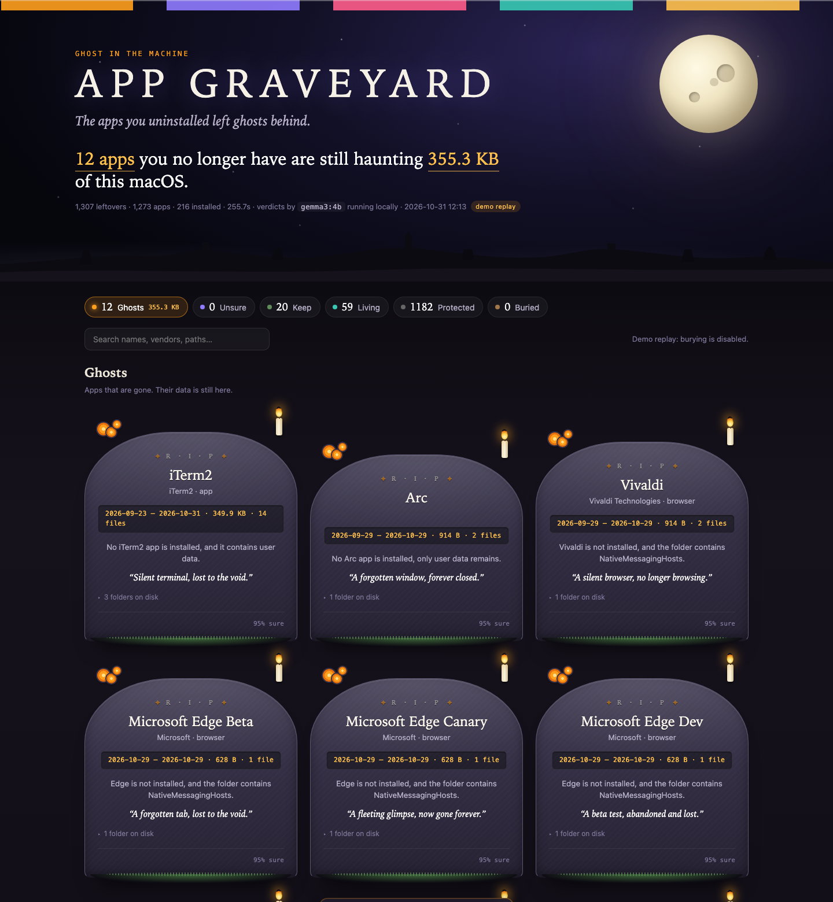

*This is a submission for the [Hacktoberfest Open-Source AI Challenge Week 4: Ghost in the Machine](https://dev.to/challenges/hacktoberfest-week4-2026-10-26)*

## What I Built

Uninstalling an app does not remove it. It removes the icon. The caches, preferences, logs and containers it wrote stay in your application-data folders forever, and nothing ever looks at them again.

**App Graveyard** finds those leftovers, works out which installed app each one belongs to, and asks an open-weight model running on your own laptop to identify the rest: what the app was, who made it, and whether it is safe to put to rest. Each dead app gets a tombstone, a verdict and an epitaph. "Bury" moves its folders to a quarantine with a manifest; "Restore" puts them back. Nothing is ever deleted.

It runs on macOS, Windows and Linux, offline, with no API key. The only network call in the code is to `127.0.0.1:11434`, which is Ollama.

## Demo



**Open https://raushanichaudhary.github.io/app-graveyard/** and follow the three steps on the page. The page itself connects to a 1 MB helper on your own machine and runs the scan from there, so the site is the app, not a brochure.

Offline, double-clicking the helper opens the same page from `127.0.0.1`. Or from a terminal, a run on a one-month-old Mac:

```
$ python -m appgraveyard
  summoning installed apps...
  216 installed apps found
  1307 leftovers scanned, folded into 1273 apps, 18 belong to nothing installed
  consulting gemma3:4b  18/18
  12 ghosts haunting 355.3 KB, 0 unsure (0 B), 59 still living, 1182 protected
  graveyard open at http://127.0.0.1:7777/
```

## Code



MIT, Python standard library only, no dependencies beyond Ollama.

## How I Built It

The pipeline has four stages, and only the last one is AI.

**1. Scan.** Walk the direct children of the leftover roots: on macOS that is `~/Library/{Application Support, Caches, Preferences, Logs, Containers, Group Containers, Saved Application State, HTTPStorages, WebKit}`; on Windows `%APPDATA%`, `%LOCALAPPDATA%`, `LocalLow` and `ProgramData`; on Linux `~/.config`, `~/.cache`, `~/.local/share`. Measure size, file count, first and last modification date, and remember a few child names. Read-only.

**2. Match, with no AI.** Build the list of installed apps (bundle ids and names from `.app` bundles plus Homebrew on Mac; registry uninstall keys, Program Files and Store packages on Windows; desktop entries, dpkg, flatpak and `$PATH` on Linux). Tokenise both sides and compare. The one rule that mattered: a word shared by three or more installed apps (`microsoft`, `google`, `zoom`) is a vendor word and never proves an app is installed on its own. Before that rule, a leftover Edge profile hid behind VS Code because both say "microsoft".

**3. Group and protect.** Fold the folders of one app together, so `com.clipy-app.Clipy` in Application Support, Caches, HTTPStorages and Preferences becomes one Clipy with four parts. Mark anything that belongs to the OS as protected. It can never be buried.

**4. Consult the ghost.** Everything still unexplained goes to Gemma 3 4B through Ollama, four apps per call, with JSON output forced. For each app the model gets the folder names, locations, sizes, dates, sample children, and the list of installed apps from the same vendor. It returns product, vendor, category, a verdict (`ghost`, `keep`, `unsure`), a confidence, a one-line reason and an epitaph. A ghost verdict under 60% confidence is downgraded to unsure, so the model never buries on a coin flip. Anything it skips in a batch is asked again on its own.

### Things that went wrong

Most of the work was not the model. It was stopping the model from being asked the wrong question.

- **Vendor words.** The first matcher saw "microsoft" in `Microsoft Edge Beta`, found "microsoft" in VS Code's bundle id, and declared Edge alive. Fix: a token shared by three or more installed apps is a vendor word and never proves anything on its own.
- **Zoom was dead, apparently.** `ZoomChat.plist`, `ZoomPhone` and `zoomusinstall.log` never produced the token "zoom", so the model was told the product was not installed and, reasonably, called them ghosts. Fix: split CamelCase and match on prefixes, so `zoomus` finds `zoom.us`. Lesson: if the context you hand the model is wrong, a confident answer is worse than no answer.
- **The model wanted to bury things it should not.** It called the pip cache and the Office group container ghosts, because no `.app` is named "pip". So two things never reach the model at all: caches of command-line developer tools, and shared containers of a developer team that still has apps installed. Rules first, model last.
- **Where Gemma still gets it wrong.** It kept `com.clipy-app.Clipy` at 85% ("preferences may be reused"); Clipy is gone. It kept the main `Microsoft Edge` folder because other Microsoft apps are installed, while correctly burying Edge Beta, Dev and Canary one call earlier. Both are in the screenshot above, unedited. A 4B model is a good intern, not an auditor, which is why every verdict is a move, not a delete.
- **Batches.** Six apps per call made the model skip or reorder items. Four per call, matched by name instead of position, with a single-item retry pass, dropped that to zero on this machine.

### The numbers

On a one-month-old MacBook with 8 GB of RAM:

| | |
| --- | --- |
| Leftover folders and files scanned | 1,307 |
| Folded into apps | 1,273 |
| Protected (operating system) | 1,182 |
| Living (matched to an installed app) | 59 |
| Kept by rule (dev caches, shared vendor containers) | 14 |
| Sent to Gemma 3 4B | 18 |
| Declared ghosts | 12 (355 KB) |
| Wrong verdicts, by my own count | 2 |
| Scan time, model included | about 2.5 minutes |

The small size is the point: a new laptop has small ghosts. My sister's three-year-old Windows machine is the real test, and the Windows paths are in the code waiting for it.

## Why Does Open Innovation Matter?

The input to this tool is a list of every application you have ever used, with paths, dates and file names. That is a profile of you. Uploading it to a hosted model to ask "which of these are dead" would be a strange trade: giving away the most complete inventory of your digital life to clean up a few hundred megabytes.

With an open-weight model it never leaves the laptop. A quantised 4B Gemma on a machine with 8 GB of RAM identified "com.clipy-app.Clipy" as a clipboard manager, knew that OneAuth is a Microsoft auth broker still used by Office, and wrote a tombstone for each dead browser channel. It did all of that offline, for free, and you can swap the model with one environment variable. The same tool with a cloud API would need a key, a bill, and a privacy policy.

## The Spirit of It

Día de los Muertos is about remembering, not erasing. App Graveyard does not delete anything. It gives each dead app a marigold, a candle and a line of remembrance, and moves it to a quarantine you can reopen. The ghost in your machine is just data nobody came back for.

## Prize Categories

**Best Use of Gemma**
